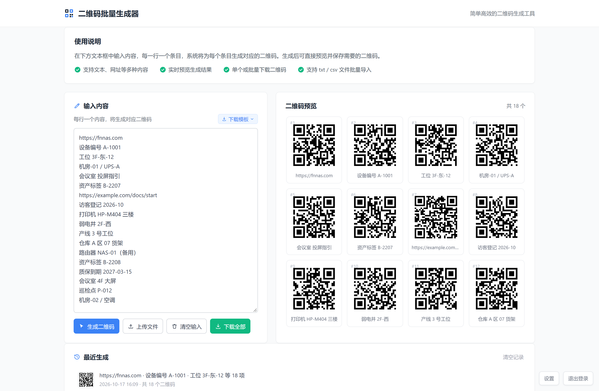
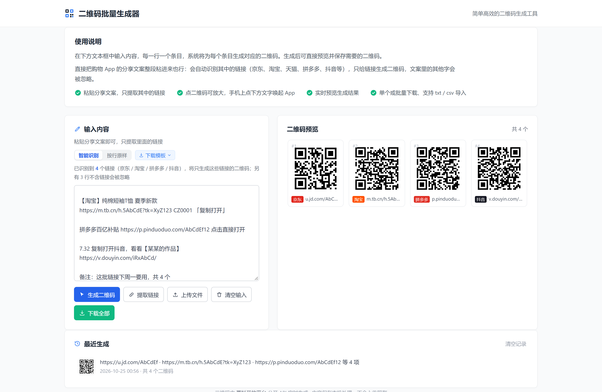

# ToQR — 二维码批量生成器（飞牛 fnOS 原生应用）

一个跑在[飞牛 fnOS](https://www.fnnas.com/)上的二维码批量生成器，以原生 `.fpk` 应用形式打包。把一批文本/链接粘贴进去，一键批量出码，支持在线预览、打包下载、历史记录。

**v1.2.1 起支持购物分享文案智能识别**：整段粘贴京东/淘宝/拼多多/抖音等 App 的分享文案，自动挑出其中的链接（只给链接出码），点码放大，手机上点链接直接跳转对应 App。



## 功能特性

| 功能 | 说明 |
|---|---|
| 批量生成 | 多行文本按行出码，实时预览，打包下载 PNG |
| 链接识别 | 粘贴任意分享文案，自动提取链接（京东 `u.jd.com` / `item.jd.com` / `3.cn`、淘宝 `m.tb.cn`、天猫、拼多多、抖音、小红书等，也认不带协议的短链），重复链接自动去重（v1.2.0） |
| 模式切换 | 「智能识别 / 按行原样」随时切换，选择会被记住；另有「提取链接」按钮一键抽取（v1.2.0） |
| 点码放大 | 点任意二维码弹出 800px 大图，可下载、复制、用浏览器打开（v1.2.0） |
| 手机跳 App | 卡片下方显示「平台标签 + 短链」，手机点击直接通过 App 协议唤起（`taobao://` / `openapp.jdmobile://` 等），没装 App 时提示后再点一次走网页（v1.2.1） |
| 同源代理 | 二维码图片经服务端 `/qr` 代理取回，跨域失败自动回退直连，再失败显示占位图（v1.0.3） |
| 历史记录 | 最近 50 条记录本地保存，可缩略图回看、点击回填 |




## 安装

在飞牛 fnOS 的 **App 中心 → 手动安装** 上传 `fnos-qrcode_1.2.1.fpk`（见 [Releases](../../releases)）。

安装包指纹（v1.2.1）：

| 项 | 值 |
|---|---|
| 大小 | 102,688 字节 |
| MD5 | `c580a125ef28c7ab910f00f590a19c81` |
| SHA256 | `ca133ad28ac5afb7625e395cb7aa04d2f46dad09df6d870c009191a5d0c3e937` |

## 使用

1. 浏览器打开 `http://<NAS IP>:12990`
2. 粘贴文本或分享文案 → 生成 → 预览
3. 单张右键另存，或多选打包下载 zip

完整说明见 [fnos-qrcode/fpk/README-USER.md](fnos-qrcode/fpk/README-USER.md)。

## 构建

```bash
cd fnos-qrcode/fpk
bash build-fpk.sh
```

产物为 `fnos-qrcode_<版本号>.fpk` 与同名 `.zip`（用于论坛附件）。无 `fnpack` 环境时回退到内置打包器 `tools/build_fpk.py`。

## 目录结构

```
fnos-qrcode/
├── fpk/                 # 应用包源（manifest / wizard / app）
│   ├── app/
│   │   ├── server/      # Python HTTP 服务（端口 12990）
│   │   └── ui/          # 前端（构建时由仓库根 index.html 同步）
│   ├── tools/           # 内置打包器
│   └── build-fpk.sh     # 构建脚本
├── html/fnos-qrcode/    # 静态预览副本
├── screenshots/         # 截图
└── FORUM-POST.md        # 论坛发布帖文案
```

## 更新日志（节选）

- **1.2.1** 手机点链接直接跳 App，不再经停淘宝等平台的强制登录页；唤起失败提示后再点一次走网页；灯箱新增「用浏览器打开」
- **1.2.0** 粘贴即只出链接（智能识别 / 按行原样 / 提取链接按钮）；点码放大；卡片「平台标签 + 短链」
- **1.1.0** 打包下载（zip）、生成历史、一键登录
- **1.0.3** 二维码图片同源代理 + 直连回退 + 占位图兜底

完整 changelog 见 [fnos-qrcode/fpk/manifest](fnos-qrcode/fpk/manifest)。
