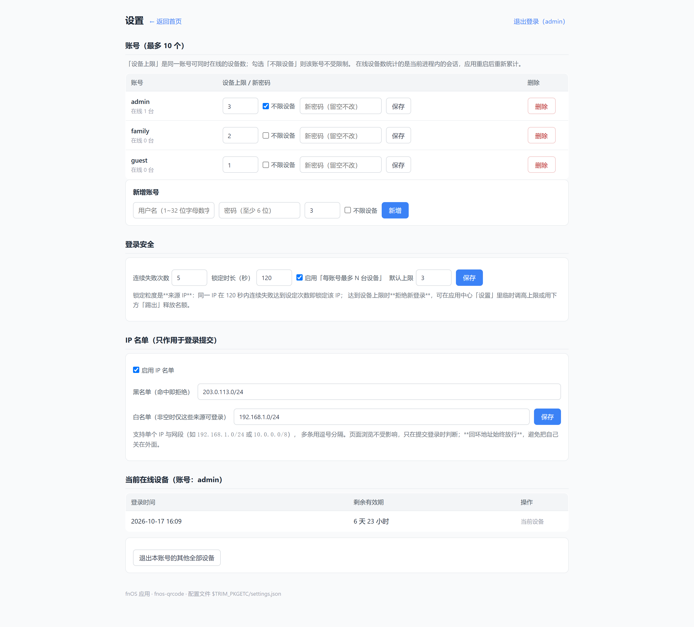
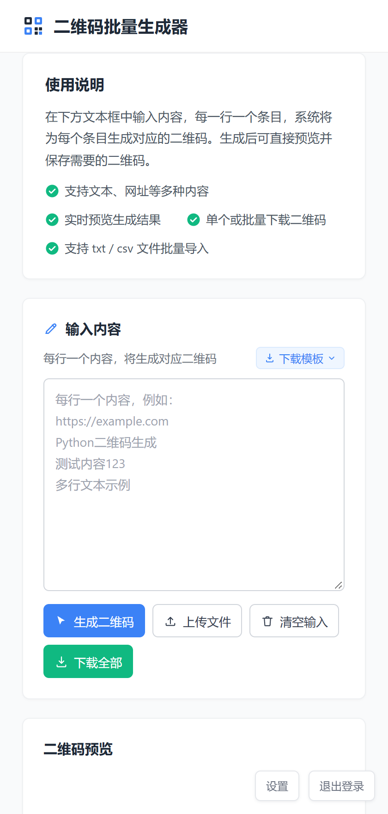

# 【自制应用】二维码批量生成器 · 飞牛 fnOS 原生应用（v1.2.0）

> 发帖说明（发出去时删掉这一段）
>
> 1. 本文用 Markdown 写的。多数论坛编辑器支持直接粘贴渲染后的内容：先用任意 Markdown 预览工具打开本文件、全选复制，再粘贴到论坛编辑器，标题、列表和图片会保留。
> 2. 配图已经拍好放在 `screenshots/`（`01-home.png` 等），发帖时按文中顺序上传即可，文末有对照表。
> 3. 附件请上传 `fnos-qrcode.fpk`，正文里的 MD5 与包内保持一致，方便别人核对。
> 4. 截图里用的是演示账号（admin / family / guest），没有真实 IP 和密码，可以直接用。

---

一句话：**在飞牛上装一个「一次生成一整批二维码」的小工具**。一行一条内容，几十上百个码一次性出，能单张下载，也能打包成一个 zip。

购物链接更是直接粘分享文案就行——**只给里面的链接出码**，文案里的字自动忽略。

- 应用中心手动安装 `.fpk`，装完桌面出图标，点开就是页面
- 纯 Python3 标准库，不需要 node、不需要 Docker、不联网装依赖
- 端口可改、登录认证可选，账号与登录安全都能自己调
- 二维码内容只在你的浏览器和接口之间走，**不写盘、不上传**

---

## 一、为什么做这个

做设备台账、资产标签、工位编号这类活儿时，经常要一口气生成几十上百个二维码。走过的弯路大概是这样：

| 做法              | 卡在哪                                                             |
| --------------- | --------------------------------------------------------------- |
| 在线二维码网站         | 一次只能填一个，80 个编号要点 80 次；下载下来还是 `qrcode.png`、`qrcode(1).png`，得手动改名 |
| 装个 Windows 桌面工具 | 为了一次性任务开虚拟机 / 装客户端，太重                                           |
| 自己写脚本           | 其实能用，但换个手机、换台电脑就不方便了，同事也不会跑                                     |

所以就写成了飞牛的原生应用：**装在 NAS 上，局域网里任何一台设备打开浏览器就能用**，不用在每台电脑上装东西。

---

## 二、它能做什么

**粘贴分享文案，只出链接**（v1.2.0 新加，也是现在最常用的用法）
从京东 / 淘宝 / 拼多多 / 抖音复制的分享文案，往往是「一堆商品标题 + 夹在中间的链接」。整段粘进来点生成，**只给那几条链接出码**，标题、「点击链接直接打开」这些字自动忽略。不带 `https://` 的短链也认得出来。

输入框上方会实时告诉你「识别到 4 个链接（京东 / 淘宝 / 拼多多 / 抖音），另有 3 行不含链接会被忽略」；想按行原样出码，右上角一键切回去就行。另外有个 **「提取链接」按钮**，不想依赖模式判断时直接点它。

**点码放大，手机上点文字直接进 App**
点二维码弹出大图（800px，比预览更清楚），可以下载这张、复制链接。卡片下方那行「平台标签 + 短链」，**在手机上点一下就跳转**——先走 https 通用链接唤起 App，没唤起来再试 App 协议。

**批量生成**  
一行一条内容，一次最多 **200 条**，支持网址也支持纯文本（中文没问题）。

**从文件导入**  
支持 `.txt` / `.csv` / `.tsv`，也可以直接把文件**拖到输入框**上。页面里内置了 CSV 和 TXT 两种模板下载，CSV 带表头，可以直接用 Excel 编辑好再导进来。

**预览与下载**  
生成后网格预览，每张带序号角标：

- 单张下载 → 直接存 PNG（400×400）
- 一键打包 → 全部打成一个 `qrcodes_<时间戳>.zip`

**最近记录**  
最近 **8 次**生成会存在浏览器本地，点一下就能把当时的内容重新载入，改两个字再生成，不用重新贴一遍。

**账号与登录安全（可选，默认不开）**

- **多账号**，最多 10 个，适合家里人 / 同事各用各的
- 每个账号能单独设「最多几台设备同时登录」，也可以给某个账号勾上**不限设备**
- 登录连续失败次数、锁定时长都能改（默认 5 次 / 120 秒）
- 登录 IP 黑白名单，支持网段（`192.168.1.0/24`）
- 应用内「设置」页可以看当前在线的设备，并把别的设备**踢下线**

> 不需要登录的场景（家里自用、内网可信）直接关掉就行，关掉后就是个纯粹的二维码工具，打开即用。

---

## 三、界面

左边输入、右边预览，下面是最近生成记录。就是个普通网页，浏览器怎么开都行，手机上也一样能用。

每张码左上角有序号、下面标着内容，扫一眼就知道哪个是哪个。

v1.1.0 新增的设置页：账号、登录安全、IP 名单、在线设备，都在这儿。

开了认证的话，打开先到登录页；手机端是自适应的单列：

手机端是自适应的单列；v1.2.0 的链接卡片在手机上长这样，点下方那行文字就直接跳：

---

## 四、安装

**三步，全程在网页里点。**

1. 应用中心 → 左下角**设置** → 打开「**手动安装**」开关（只需开一次）
2. 应用中心 → 左下角「**手动安装**」→ 选择 `fnos-qrcode.fpk`
3. 跟着向导填：

| 向导步骤  | 填什么                   | 能不能跳过        |
| ----- | --------------------- | ------------ |
| 服务端口  | 默认 `10001`，1024~65535 | 不能，但可以就用默认值  |
| 用户认证  | 开 / 不开，开启时填用户名密码      | 可以，默认不开      |
| 登录安全  | 失败次数、锁定时长、设备上限        | 可以，全部留空＝保持默认 |
| IP 名单 | 黑白名单                  | 可以，默认不启用     |

1. 装完在应用中心点「**启用**」，桌面随即出现「二维码批量生成器」图标

**关于端口**：装好之后随时能改，改完应用自动重启、桌面图标的入口端口跟着变，不需要重新打包。

---

## 五、装好之后在哪改

设置分两处，用途不一样：

| 入口           | 怎么进                              | 能改什么                                  | 需要登录吗 |
| ------------ | -------------------------------- | ------------------------------------- | ----- |
| **应用中心「设置」** | 桌面图标右键 → 管理应用 → 应用设置 → 运行设置 → 编辑 | 端口、认证开关、失败次数、锁定时长、设备上限、IP 名单          | 不需要   |
| **应用内「设置」页** | 登录后右下角「设置」                       | 账号增删改、改密码、单账号设备上限、IP 名单、**在线设备查看与踢出** | 需要    |

应用中心那一层是**逃生通道**：万一账号密码忘了、或者设备超限进不去，可以在这里重设密码或调高上限，不需要先登录。

---

## 六、v1.2.0 更新了什么

**新增：粘贴即只出链接**

1. **链接识别**：从文本里认出所有链接并只给它们出码。京东（`u.jd.com` / `item.jd.com` / `3.cn`）、淘宝（`m.tb.cn`）、天猫、拼多多、抖音、小红书、快手、1688、微博、B站、美团、饿了么这些平台会带中文标签；其他网址一并识别，标签显示「链接」。**不带 `https://` 的短链也认**，同一条链接重复出现自动去重。
2. **两种模式**：输入框上方「智能识别 / 按行原样」随时切，选择会被记住；切模式会清掉上一轮的结果，不会看得一头雾水。
3. **「提取链接」按钮**：不想依赖模式判断时直接点它，它只干一件事——把当前文本里的链接挑出来出码；一条链接都没有时会明确提示，不会静默生成一堆文字码。
4. **实时提示**：「已识别到 4 个链接（京东 / 淘宝 / 拼多多 / 抖音），另有 3 行不含链接会被忽略」，生成前就能发现有没有漏。
5. **点码放大**：点任意二维码弹出大图（按 800px 取，高分屏不糊），能「下载这张」「复制链接」，Esc 或点遮罩关闭。
6. **卡片下方可点**：每张码下面显示「平台标签 + 短链」。**手机上点它**先走 https（系统通用链接唤起 App），1.2 秒内没被接管再试该平台的 App 协议；桌面端则在新标签打开。

**改动**

- 链接条目的卡片文字变成「平台标签 + 短链」，比原来整条 URL 更容易分辨；非链接内容维持原样
- 二维码规格没变（400×400，打包下载还是 400），只有放大查看走 800

**兼容**

- 老用法完全不变：文本里没有链接时照样按行出码；想强制按行，切到「按行原样」即可
- 升级方式仍是「卸载 → 重装」，端口、账号、登录设置都保留

**上一版（v1.1.0）回顾**

- 多账号（最多 10 个），每个账号独立密码与设备上限，可单账号设为「不限设备」
- 登录安全可配：连续失败次数（默认 5）、锁定时长（默认 120 秒）
- 登录 IP 黑白名单，支持网段，回环始终放行
- 应用内设置页：账号增删改、安全参数、IP 名单、在线设备查看与踢出
- 修复「**登录框里输入中文，页面直接报 `ERR_EMPTY_RESPONSE`**」——原因比较隐蔽：比较用户名用的是 `hmac.compare_digest`，它在 Python 里**只接受纯 ASCII**，遇到中文就抛 `TypeError`，异常又没被捕获，连接被直接关掉、一个字节都没返回。现在改成先编码成 UTF-8 字节再比较，并且给请求处理加了兜底——**任何未预期异常都返回 500，不会再静默断开**。
- `Server` 响应头不再带 `Python/3.x.y` 版本号

---

## 七、几个刻意的取舍（先说清楚，省得踩坑）

这些坑我自己都踩过，所以索性先摆出来——都是**已知并且有意为之**的取舍，不是没做完：

1. **二维码由第三方公开接口生成**（草料开放平台的公开接口），所以 **NAS 需要能访问外网**才能出码。为此服务端做了个同源转发（`/qr`），顺带解决了「打包下载 zip」在真实部署上必定被 CORS 拦掉的问题。如果 NAS 完全没外网，前端会退回到浏览器直连——这时要求你打开页面的那台设备能上外网。
2. **登录锁定按来源 IP 记，且不豁免内网**。早期版本豁免了回环和私网，结果在局域网部署下**永远触发不了锁定**，功能等于没开；现在取消了。代价是共享出口 IP（反向代理 / NAT）时，一个人输错 5 次会连带锁掉同 IP 的所有人。反代场景请把代理出口 IP 加进白名单或在代理层限流。
3. **设备超限是拒绝新登录，不是挤掉旧设备**。这是按需求刻意选的：突然被踢下线比登不上去更让人困惑。自救办法见上面那张表。
4. **限流计数和设备登记表都在进程内存里**，重启应用即清零。好处是不用碰配置目录的写权限，代价是「重启应用」能绕过锁定与设备上限。真要防暴力破解，建议在网络层另做限制。
5. **IP 名单只作用于「提交登录」这一步**。名单外的来源仍能打开页面、使用已登录的会话，只是登不进去。要整站封禁请在路由 / 反代上做。
6. **升级按「卸载 → 重新安装」**&#x5904;理（飞牛目前对第三方应用都是这样），`upgrade_*` 脚本已实现，端口和认证设置不会被覆盖。
7. **手机唤起 App 是「https 优先」**。先让系统用通用链接去唤起，只有页面在 1.2 秒内没被接管才回落到 App 协议。所以如果 https 很快把网页打开了，就**不会**再强行弹协议——好处是不会出现「网页开了又闪一下跳走」，代价是部分短链只能停在网页版。另外各平台的协议并不都公开稳定，唤起失败时会在页面上提示「长按链接复制后到 App 里打开」。
8. **链接识别是「有链接就只出链接」**。一份文本里既有链接又有要单独做码的文字时，会只出链接的码——想混着来就切到「按行原样」，或分两次生成。

---

## 八、常见问题

| 现象                  | 原因                                             | 怎么办                                                   |
| ------------------- | ---------------------------------------------- | ----------------------------------------------------- |
| 启用时提示「端口被占用」，换端口也一样 | 1.0.0 的 manifest 写死 `service_port`，而应用中心只认这个字段 | 用 1.0.1 以后的版本（已改 `checkport = false`）                 |
| 启用成功但页面打不开          | 端口真被别的服务占了                                     | 看应用数据目录下的 `app.log`（搜 `Address already in use`），换空闲端口 |
| 被锁定了想立刻登录           | 计数在进程内存里                                       | 等 120 秒，或应用中心「停用 → 启用」                                |
| 提示「已达到 N 台设备上限」     | 账号开了设备限制且在线设备已满                                | 应用内「设置」踢旧设备，或在应用中心调高上限 / 关掉限制                         |
| 忘了密码                | —                                              | 应用中心「设置」里填个新密码即可（留空＝不改）                               |
| 自己打不开登录页了（IP 名单配错）  | 白名单漏了自己的 IP                                    | 回环地址始终放行，用 NAS 本机的浏览器访问即可                             |
| 出码全部失败              | NAS 出不了外网                                      | 确认 NAS 能访问 `api.2dcode.biz`                           |
| 卸载时被提示改从 Web UI 卸载  | 带向导的应用不支持命令行卸载                                 | 用应用中心卸载                                               |
| 粘贴了一堆文案，只出来两三个码    | 智能识别模式下只给链接出码                                  | 这是预期行为；要按行出码就切到「按行原样」                                 |
| 手机上点链接只开了网页，没进 App | 系统没把这条短链交给 App，或该平台协议不公开                       | 长按链接复制后到 App 里打开；不是 bug                                |

---

## 九、下载

| 项      | 值                                                                  |
| ------ | ------------------------------------------------------------------ |
| 文件名    | `fnos-qrcode.fpk`                                                  |
| 版本     | 1.2.0                                                              |
| 大小     | 101,839 字节（约 99.5 KB）                                              |
| MD5    | `18b8142727edf91b9d3cdd23a6f6dda8`                                 |
| SHA256 | `30dfa29307da18f98c29b86e358f31230ea665172bd989968ff12b4e126e8296` |

下载后可以先核对一下 MD5，再传到 NAS 安装。

**环境要求**：飞牛 fnOS，系统自带 `python3`（3.6 以上，飞牛自带 3.11）。安装脚本会先检查，缺了会在安装阶段就报错而不是装完起不来。

---

## 十、反馈

用着有问题、或者想要什么功能，直接在这帖下面回；能附上**版本号 + 现象 + 复现步骤**最好。日志在应用目录的 `var/app.log`，贴关键几行就够。

这版做完 114 项功能测试（正常流程 / 边界 / 异常场景全覆盖），但毕竟测试环境有限，真机上的边界情况还得靠大家撞出来。

---

## 配图清单（发帖时删掉本节）

截图是用发布包里的真实 `app.py` 起实例、Chrome 无头浏览器实拍的，**演示账号 + 演示内容，没有真实 IP 和密码**，可以直接上传。

| 文件                            | 内容                               | 像素        | 大小     |
| ----------------------------- | -------------------------------- | --------- | ------ |
| `screenshots/01-home.png`     | 首页全貌（18 条内容 + 预览 + 最近记录）         | 2880×1880 | 360 KB |
| `screenshots/02-preview.png`  | 生成后的网格预览                         | 1246×1210 | 119 KB |
| `screenshots/03-settings.png` | 应用内设置页（账号 / 登录安全 / IP 名单 / 在线设备） | 2880×2606 | 339 KB |
| `screenshots/04-login.png`    | 登录页                              | 2000×1120 | 38 KB  |
| `screenshots/05-mobile.png`   | 手机端自适应                           | 840×1760  | 135 KB |
| `screenshots/06-links.png`    | v1.2.0 粘贴分享文案，只出链接               | 2880×1880 | 349 KB |
| `screenshots/07-lightbox.png` | 点二维码放大（灯箱）                       | 2880×1880 | 465 KB |
| `screenshots/08-mobile-links.png` | 手机端的链接卡片与识别提示                | 780×1688  | 89 KB  |

都是 2 倍分辨率（Retina）截的，论坛缩放后依然清晰。如果论坛卡上传体积，`01-home.png` 和 `03-settings.png` 按 50% 缩一下再传即可。
